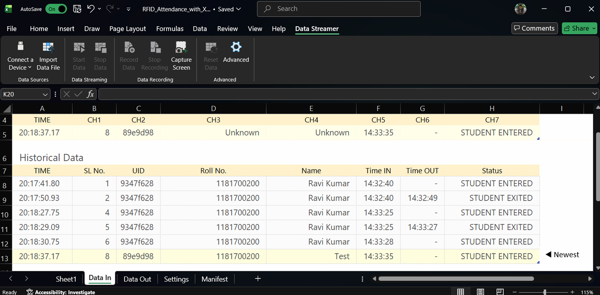

# RFID Based Attendance System using Arduino

## Project Overview
This project is an automated attendance system built using an **Arduino Uno** and the **MFRC522 RFID module**. It allows users to check in and check out by scanning their RFID cards. The system logs the **Data** (Card UID, Name, Roll Number), **Time In**, **Time Out**, and **Status** (Entered/Exited).

The data is transmitted via the Serial interface in a **CSV (Comma Separated Values)** format, which can be directly logged into Microsoft Excel for record-keeping.

## Project Documentation
For a detailed explanation of the project's methodology, results, and presentation, please refer to the attached documents:

- 📄 **[Project Report](public/Project%20Report.pdf)** - Full technical report.
- 📊 **[Project Presentation (PPT)](public/RFID-Based%20Attendance%20System%20with%20Arduino%20UNO%20PPT.pdf)** - Presentation slides used for demonstration.

## Features
- **Real-time Detection**: Instantly detects and reads RFID cards.
- **Entry/Exit Logic**: Automatically tracks if a user is entering or exiting based on their previous status.
- **Data Logging**: Outputs data in a structured CSV format.
- **Timekeeping**: Uses Arduino's internal software clock (millis) to track time.

## Circuit Wiring
The MFRC522 module operates on **3.3V**. **DO NOT connect it to 5V**, as it may damage the module.

"C:\Users\KIIT\Downloads\circuit_diagram.png"

| MFRC522 Pin | Arduino Uno Pin |
|-------------|-----------------|
| SDA (SS)    | Pin 10          |
| SCK         | Pin 13          |
| MOSI        | Pin 11          |
| MISO        | Pin 12          |
| IRQ         | *(Not Connected)*|
| GND         | GND             |
| RST         | Pin 9           |
| 3.3V        | 3.3V            |

## Library Requirements
You need to install the **MFRC522** library by GithubCommunity (or similar) in the Arduino IDE.
1. Open Arduino IDE.
2. Go to **Sketch** > **Include Library** > **Manage Libraries...**
3. Search for `MFRC522`.
4. Install the latest version.

## Setup & Installation
1. **Connect the Components**: Wire the RFID module to the Arduino as per the circuit diagram above.
2. **Open the Code**: Open `Codes & Excel Sheet/RFID_Attendance_with_XLSX.ino` in Arduino IDE.
3. **Configure Users**:
   - The code currently has pre-registered users (e.g., Muskan Verma, Harsh Srivastava).
   - You can add more users by adding their Name, Roll Number, and Card UID to the `userList` array in the code.
4. **Upload**: Connect the Arduino to your PC and click **Upload**.
5. **Open Serial Monitor**:
   - Set Baud Rate to **9600**.
   - You will see the header row printed.
   - Scan a card to see the attendance log.

## Connecting to Excel (Excel Sheet Integration)
To save the data to the attached Excel sheet, you can use the provided template:
- 📗 **[Download Excel Sheet Template](Codes%20&%20Excel%20Sheet/RFID_Attendance_with_XLSX.xlsx)**

### Option 1: Excel Data Streamer (Recommended for Live Logging)
1. Enable the **Data Streamer** add-in in Excel (File > Options > Add-ins > COM Add-ins).
2. Connect your Arduino via USB.
3. In Excel, go to the **Data Streamer** tab -> **Connect Device** -> Select your Arduino COM Port.
4. Click **Start Data**. The Serial output from the Arduino will populate the sheet in real-time.

### Option 2: Copy-Paste
1. Open the Serial Monitor.
2. Let the attendance run for the session.
3. Copy the output text.
4. Open Excel, paste the data, and use **Data -> Text to Columns** (delimited by comma) to format it.

## Project Structure
- `Codes & Excel Sheet/RFID_Attendance_with_XLSX.ino`: The main firmware logic.
- `Codes & Excel Sheet/RFID_Attendance_with_XLSX.xlsx`: Template for storing attendance records.
- `public/`: Contains the Project Report, Presentation (PPT), and images.
